<!--
  README.md is generated from this file. Edit README.tmpl.md and data/board.json, not README.md.
  Rebuild with: node scripts/build.mjs   ·   Gate: npm test   ·   Source check: node scripts/verify-board.mjs
-->

<picture><source media="(prefers-color-scheme: dark)" srcset="assets/board/header-dark.svg"><source media="(prefers-color-scheme: light)" srcset="assets/board/header-light.svg"></picture>

<picture><source media="(prefers-color-scheme: dark)" srcset="assets/board/lane-supply-chain-dark.svg"><source media="(prefers-color-scheme: light)" srcset="assets/board/lane-supply-chain-light.svg"></picture>

<a href="https://tarang-tj.github.io/aero-supplier-spend/"><picture><source media="(prefers-color-scheme: dark)" srcset="assets/board/tile-aero-dark.svg"><source media="(prefers-color-scheme: light)" srcset="assets/board/tile-aero-light.svg">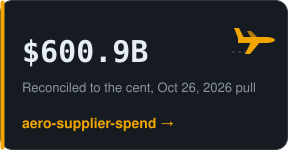</picture></a>
<a href="https://tarang-tj.github.io/bullwhip-audit/"><picture><source media="(prefers-color-scheme: dark)" srcset="assets/board/tile-bullwhip-dark.svg"><source media="(prefers-color-scheme: light)" srcset="assets/board/tile-bullwhip-light.svg">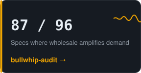</picture></a>
<a href="https://tarang-tj.github.io/starship-flow-control/"><picture><source media="(prefers-color-scheme: dark)" srcset="assets/board/tile-starship-dark.svg"><source media="(prefers-color-scheme: light)" srcset="assets/board/tile-starship-light.svg">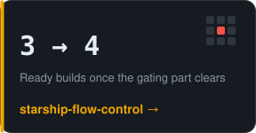</picture></a>

<picture><source media="(prefers-color-scheme: dark)" srcset="assets/board/lane-finance-dark.svg"><source media="(prefers-color-scheme: light)" srcset="assets/board/lane-finance-light.svg"></picture>

<a href="https://tarang-tj.github.io/p2p-match-audit/"><picture><source media="(prefers-color-scheme: dark)" srcset="assets/board/tile-p2p-dark.svg"><source media="(prefers-color-scheme: light)" srcset="assets/board/tile-p2p-light.svg">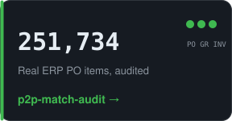</picture></a>
<a href="https://github.com/tarang-tj/quant-liquidity-execution-research"><picture><source media="(prefers-color-scheme: dark)" srcset="assets/board/tile-quant-dark.svg"><source media="(prefers-color-scheme: light)" srcset="assets/board/tile-quant-light.svg">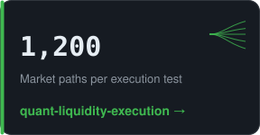</picture></a>
<a href="https://github.com/tarang-tj/kalshi-weather-engine-report"><picture><source media="(prefers-color-scheme: dark)" srcset="assets/board/tile-kalshi-dark.svg"><source media="(prefers-color-scheme: light)" srcset="assets/board/tile-kalshi-light.svg">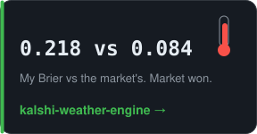</picture></a>

<picture><source media="(prefers-color-scheme: dark)" srcset="assets/board/lane-data-dark.svg"><source media="(prefers-color-scheme: light)" srcset="assets/board/lane-data-light.svg"></picture>

<a href="https://tarang-tj.github.io/economic-pulse-dashboard/"><picture><source media="(prefers-color-scheme: dark)" srcset="assets/board/tile-econ-dark.svg"><source media="(prefers-color-scheme: light)" srcset="assets/board/tile-econ-light.svg">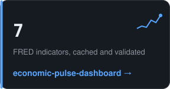</picture></a>
<a href="https://github.com/tarang-tj/ecommerce-sql"><picture><source media="(prefers-color-scheme: dark)" srcset="assets/board/tile-ecom-dark.svg"><source media="(prefers-color-scheme: light)" srcset="assets/board/tile-ecom-light.svg">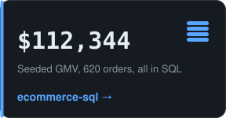</picture></a>
<a href="https://tarang-tj.github.io/wa-housing-homelessness/"><picture><source media="(prefers-color-scheme: dark)" srcset="assets/board/tile-wa-dark.svg"><source media="(prefers-color-scheme: light)" srcset="assets/board/tile-wa-light.svg">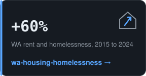</picture></a>

<picture><source media="(prefers-color-scheme: dark)" srcset="assets/board/lane-ai-dark.svg"><source media="(prefers-color-scheme: light)" srcset="assets/board/lane-ai-light.svg"></picture>

<a href="https://tarang-tj.github.io/ragproof/"><picture><source media="(prefers-color-scheme: dark)" srcset="assets/board/tile-ragproof-dark.svg"><source media="(prefers-color-scheme: light)" srcset="assets/board/tile-ragproof-light.svg">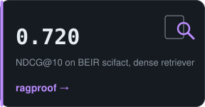</picture></a>
<a href="https://github.com/tarang-tj/claude-skill-audit"><picture><source media="(prefers-color-scheme: dark)" srcset="assets/board/tile-skill-audit-dark.svg"><source media="(prefers-color-scheme: light)" srcset="assets/board/tile-skill-audit-light.svg">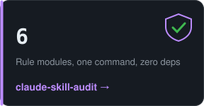</picture></a>
<a href="https://github.com/tarang-tj/rescue-relay"><picture><source media="(prefers-color-scheme: dark)" srcset="assets/board/tile-relay-dark.svg"><source media="(prefers-color-scheme: light)" srcset="assets/board/tile-relay-light.svg">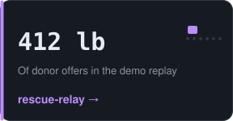</picture></a>

<picture><source media="(prefers-color-scheme: dark)" srcset="assets/board/lane-after-hours-dark.svg"><source media="(prefers-color-scheme: light)" srcset="assets/board/lane-after-hours-light.svg"></picture>

<a href="https://tarang-tj.github.io/tycho/"><picture><source media="(prefers-color-scheme: dark)" srcset="assets/board/tile-tycho-dark.svg"><source media="(prefers-color-scheme: light)" srcset="assets/board/tile-tycho-light.svg">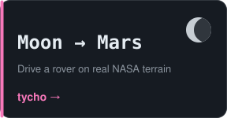</picture></a>
<a href="https://tarang-tj.github.io/spectra-vision/"><picture><source media="(prefers-color-scheme: dark)" srcset="assets/board/tile-spectra-dark.svg"><source media="(prefers-color-scheme: light)" srcset="assets/board/tile-spectra-light.svg">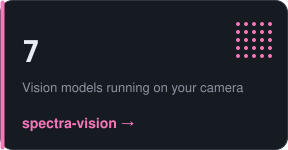</picture></a>
<a href="https://tarang-tj.github.io/3d-ramenshop-portfolio/"><picture><source media="(prefers-color-scheme: dark)" srcset="assets/board/tile-ramen-dark.svg"><source media="(prefers-color-scheme: light)" srcset="assets/board/tile-ramen-light.svg">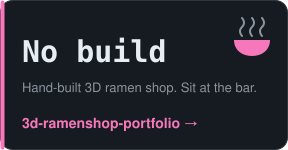</picture></a>

<b>More</b>

 

**Everything else.**
[Coke-Recap](https://tarang-tj.github.io/Coke-Recap/) (3D recap of my Coca-Cola internship) ·
[AutoAppli](https://autoappli.com) (job-search workspace) ·
[SyllabusAI](https://syllabusai.net) (syllabus to calendar, past project) ·
[the-breaker](https://github.com/tarang-tj/the-breaker) (agent kill-switch, design only) ·
[Cohort-Retention-Engine](https://github.com/tarang-tj/Cohort-Retention-Engine) ·
[Bottleneck-Simulator](https://github.com/tarang-tj/Bottleneck-Simulator) ·
[operations-forecasting-model](https://github.com/tarang-tj/operations-forecasting-model) ·
[team-cartier-dashboard](https://tarang-tj.github.io/team-cartier-dashboard/)

**Outside this account.** 10 pull requests merged into [career-ops-hq/career-ops](https://github.com/career-ops-hq/career-ops/pulls?q=is%3Apr+author%3Atarang-tj+is%3Amerged), and open ones against [NVIDIA/SkillSpector](https://github.com/NVIDIA/SkillSpector/pull/455) and [NVIDIA/cosmos-framework](https://github.com/NVIDIA/cosmos-framework/pull/317).

**About.** Applied AI at The Coca-Cola Company, Ignite Program, summer 2026. MIS at UW Bothell, class of 2027. Every number on the tiles above comes from that repo's own README, and a check in this repo fails if one stops matching.

